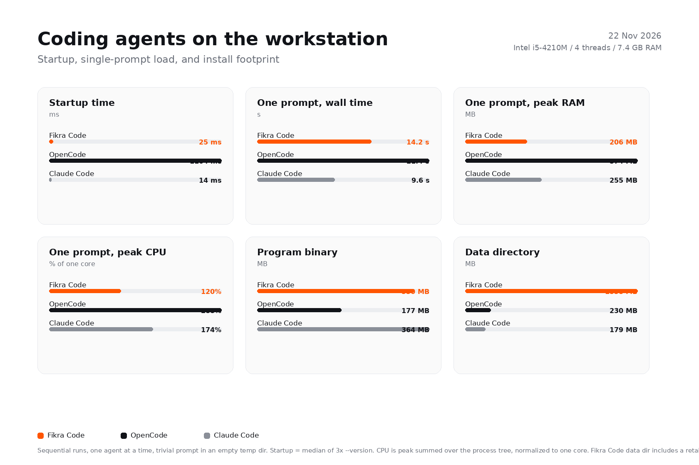

<p align="center">
  
</p>

<h1 align="center">Fikra Code</h1>

<p align="center">
  <strong>A lightweight coding agent that runs well on modest laptops and slow connections.</strong><br>
  Powered by the <a href="https://fikraapi.co.ke">Fikra API</a>.
</p>

<p align="center">
  <a href="https://fikraapi.co.ke/fikra-code">Website</a> &middot;
  <a href="https://fikraapi.co.ke/code/docs">Docs</a> &middot;
  <a href="https://fikraapi.co.ke/code/pricing">Pricing</a> &middot;
  <a href="https://fikraapi.co.ke/code/models">Models</a> &middot;
  <a href="https://fikraapi.co.ke/code/changelog">Changelog</a>
</p>

<p align="center">
  
  
  
</p>

---

Fikra Code is a small command-line coding agent. It reads a project, runs commands, edits files and reports back. It is built to stay usable on a low-end laptop and on a connection that drops, and it is designed around the [Fikra API](https://fikraapi.co.ke) as its default model provider.

## Install

Linux:

```sh
curl -fsSL https://fikraapi.co.ke/code/install.sh | sh
```

Windows PowerShell:

```powershell
irm https://fikraapi.co.ke/code/install.ps1 | iex
```


## How light is it?



Measured on a 4-thread Intel Core i5-4210M laptop with 7.6 GB RAM (22 Nov 2026), one agent at a time, one short prompt:

| | Peak RAM | Peak CPU (one core) | Startup | One prompt |
|---|---|---|---|---|
| **Fikra Code 0.1.6** | **206 MB** | **120%** | 25 ms | 14.2 s |
| Claude Code 2.1 | 255 MB | 174% | 14 ms | 9.6 s |
| OpenCode 1.19 | 574 MB | 288% | 1,104 ms | 21.4 s |

Fikra Code uses the least memory and CPU of the three, which is what matters on older laptops. Prompt time depends on the model and network as much as the agent. Method and raw data: one sequential pass on a shared machine, process-tree sampling every 50 ms.

## Sign in

```sh
fikra
```

Your browser opens [fikraapi.co.ke/code/plans](https://fikraapi.co.ke/code/plans). Pick a plan or continue free, check that the code on the page matches your terminal, and Fikra Code signs in on its own. Paying creates your account from the checkout email.

- Over SSH or on a server: `fikra login --device-auth` prints the link instead of opening a browser.
- In CI and scripts: set `FIKRA_API_KEY`, or run `printenv FIKRA_API_KEY | fikra login --with-api-key`.
- `fikra login status` shows the sign-in, `fikra logout` removes it.

## Plans

| Plan | Price | Allowance |
| --- | --- | --- |
| Free | $0 | qwen3.8-27b-free: 200 requests and 2M tokens a day, no card needed |
| Lite | $10 / month | $0.50 every 5 hours, $3 a week, every model |
| Pro | $25 / month | $1.50 every 5 hours, $8 a week, every model |
| Max | $60 / month | $5 every 5 hours, $18 a week, every model |
| Team | $100 / seat / month | Max allowances per seat, one bill |
| Kenya Weekly | KES 200 / week | M-Pesa or card, every model |

Details and limits per model: [fikraapi.co.ke/code/pricing](https://fikraapi.co.ke/code/pricing).

## Use

```sh
fikra "fix the failing tests in this repo"
```

Pick a model with `-m` or `/model` inside a session:

```sh
fikra -m fikra-auto "refactor this module"
```

Update with `fikra update` (it removes older versions so updates never pile up).

### Built-in commands

| Command | What it does |
| --- | --- |
| `/pr [title]` | Commit, push and open a GitHub pull request |
| `/issue <number>` | Fix a GitHub issue on a branch and open the PR |
| `/kaggle <owner/dataset>` | Download Kaggle data and build a starter notebook |
| `/colab [notebook]` | Make a notebook Colab-ready and get the Open in Colab link |
| `/connect` | Check GitHub, Kaggle and Colab are set up |
| `/balance` | Balance, free allowance and recent usage |
| `/upgrade` | Open the plans (KES 200/week or from $10/month) |
| `/review`, `/diff`, `/model`, `/status` | Review changes, show the diff, switch model, session info |

## Models

Every paid plan includes every model in the catalog. Prices are USD per 1M input / output tokens for pay-as-you-go, checked 2026-11-21. Full list: [fikraapi.co.ke/code/models](https://fikraapi.co.ke/code/models).

| Model | ID | Input / Output |
| --- | --- | --- |
| Qwen 3.8 27B (free, default) | `qwen3.8-27b-free` | free (200 requests and 2M tokens a day) |
| Qwen 3.8 27B (paid) | `qwen3.8-27b` | same model, paid per token, no daily cap |
| Fikra Auto | `fikra-auto` | 0.045 / 0.35 |
| Fikra Code 35B | `fikra-code-35b` | 0.045 / 0.33 |
| DeepSeek V4.1 Flash | `deepseek-v4.1-flash` | 0.1875 / 0.75 |
| Qwen 4 Max | `qwen4-max` | 1.875 / 5.625 |
| Gemini 4 Argon | `gemini-4-argon` | 2.50 / 12.00 |
| Kimi K3 | `kimi-k3` | 2.4375 / 12.1875 |
| GLM 5.3 | `glm-5.3` | 1.225 / 3.85 |

## Why Fikra Code

- Small footprint and quick start, built for modest machines.
- Resumable installers and streaming responses for slow networks.
- No telemetry by default. Analytics, feedback and OpenTelemetry exporters are off in the default configuration.
- One plan for every model, from $10 a month, or KES 200 a week with M-Pesa.
- Uses the same account and balance as the Fikra API.

## Links

- Website: [fikraapi.co.ke](https://fikraapi.co.ke)
- Fikra Code: [fikraapi.co.ke/fikra-code](https://fikraapi.co.ke/fikra-code)
- Docs: [fikraapi.co.ke/code/docs](https://fikraapi.co.ke/code/docs)
- Pricing: [fikraapi.co.ke/code/pricing](https://fikraapi.co.ke/code/pricing)
- Models: [fikraapi.co.ke/code/models](https://fikraapi.co.ke/code/models)
- Changelog: [fikraapi.co.ke/code/changelog](https://fikraapi.co.ke/code/changelog)
- Dashboard: [fikraapi.co.ke/dashboard/code](https://fikraapi.co.ke/dashboard/code)
- Status: [fikraapi.co.ke/status](https://fikraapi.co.ke/status)

## Credits

Fikra Code is based on OpenAI Codex CLI, licensed under the Apache License 2.0. See [LICENSE](LICENSE) and [NOTICE](NOTICE).
